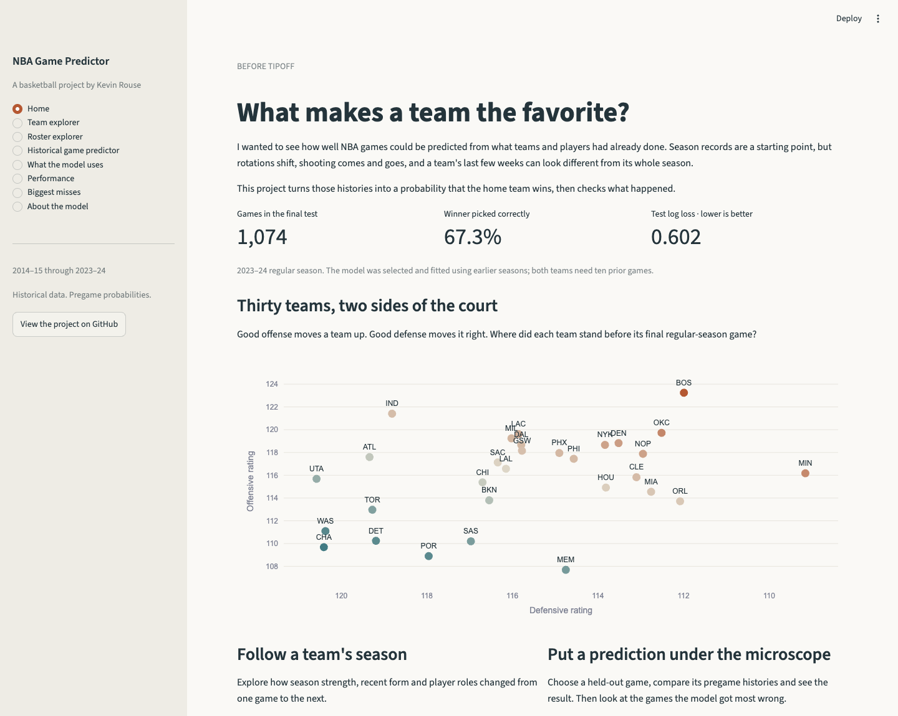

# NBA Game Predictor

I wanted to see how well NBA games could be predicted using only team and player histories available before tipoff. Season records tell part of the story, but rotations change, players miss games, and recent performance can look different from a team's full season.

This project builds a pregame home-win probability model and a Streamlit app for exploring the games behind it.

**Final test: 1,074 games in 2023–24 · 67.3% accuracy · 0.6025 log loss.**

[Explore the notebooks](notebooks/) · [Run the dashboard](#running-locally) · [Deployment instructions](docs/deployment.md)



The dashboard has been tested locally. A public Streamlit deployment is pending; there is no verified live app URL yet.

## Why I built this

I was interested in what makes one team more likely to beat another on a particular night. I started with season strength, added recent team form and historical player roles, and checked which information held up on later seasons. The result is a model I can inspect game by game, including its confident mistakes.

## How well did it work?

The model was selected using earlier seasons and frozen before evaluating 2023–24. All rows below use the same eligible games.

| Model | Log loss ↓ | Brier score ↓ | ROC AUC ↑ | Accuracy ↑ |
|---|---:|---:|---:|---:|
| Historical home win rate | 0.6929 | 0.2499 | 0.5000 | 53.7% |
| Season win percentage | 0.6122 | 0.2129 | 0.7208 | 64.9% |
| Season net rating | 0.6120 | 0.2127 | 0.7206 | 64.5% |
| **Team and player histories** | **0.6025** | **0.2080** | **0.7345** | **67.3%** |

The selected model is L1 logistic regression, with `C=0.1`. The paired log-loss difference against net rating is −0.0095, with a 95% week-block bootstrap interval of **−0.0155 to −0.0032**. That supports an improvement within this test season; it does not establish its size across future seasons.

Calibration was reasonable overall, with an offset toward home teams: 56.1% average predicted home-win probability versus 53.7% observed. The diagnostic calibration slope was 1.058. I did not use these test diagnostics to refit or recalibrate the model.

## Data

The supplied files contain **27,144 team rows × 41 columns** and **434,797 player rows × 59 columns**. There are **11,979 regular-season games**, spanning 2014–15 through 2023–24. Historical playoff records are present in the source files but are outside this model's scope.

Each game has two offensive team rows. The player file includes both participants and rostered nonparticipants. Defensive measures come from the opponent's offensive row; overlapping player on-court totals are never treated as additive team statistics.

The original CSV bytes are preserved in lossless `.csv.gz` files under `Data/`, alongside the supplied dictionary. No external basketball data, injury reports, travel data or betting prices are used. The [audit](docs/data-and-features.md) describes the few source inconsistencies.

## Building a picture before each game

- **Season strength:** win percentage, net rating, shooting efficiency, turnover rate, rebounding and free-throw rate.
- **Recent form:** five-, ten- and twenty-game team windows, evaluated during development.
- **Player roles:** historical minutes establish each player's weight. Recent shot-attempt efficiency, participation and missed-game history are weighted by that prior role.
- **Rotations:** minute concentration, starter continuity, changing minute shares, scoring concentration and shooting-role concentration.
- **Context:** rest, back-to-backs and games in the previous week.

Inputs compare home and away teams. Team counts are shifted before cumulative or rolling calculations. Player summaries use only previous games and the last observed roster, never current-game minutes, starters, production or `missed` flags. Automated mutation and truncation tests check that later records cannot alter earlier inputs.

Both teams need ten prior games that season. That leaves **10,418 eligible games**, including **9,344 development games** and **1,074 final-test games**. Opening games supply history and remain in the explorers, but do not receive predictions.

## What I learned along the way

- Player histories reduced mean validation log loss from **0.6281 to 0.6250**, improving five of six validation seasons compared with the same L1 team-only model.
- Twenty-game team form gave the lowest validation loss, **0.6244**, but its gain over the version without those extra inputs was below the prespecified 0.001 threshold. I kept the smaller version.
- Net rating was the strongest retained signal. Back-to-backs, historical absences and role-weighted scoring also had consistent directions across development fits.
- Correlated measures share credit. The final L1 fit sets minute continuity and top-five/top-seven minute share to zero; **19 of 22 candidate inputs** have nonzero coefficients.
- More flexible models were not better here. Random forests fit training games more closely but performed worse on later seasons; shallow boosting also trailed logistic regression.

These are development findings, not independent estimates of the benefit of every input. [The modeling notebook](notebooks/03_modeling.ipynb) shows the comparisons and coefficient stability.

## Exploring the predictions

The app has team and roster explorers, a historical game selector, model inputs, performance, biggest misses, and concise methodology. The game selector uses only the reserved season, with pregame probabilities clearly separated from actual results.

One notable miss: Dallas was a **91.5%** home favorite against Detroit on April 12, 2024, but lost **89–107**. The data show what the model missed, without establishing a story about injuries or late lineup changes.

## Modeling and limitations

Training begins with 2014–15 through 2016–17. Six expanding windows validate complete seasons from 2017–18 through 2022–23. I compare three basketball baselines, ordinary/L1/L2 logistic regression, random forest and gradient boosting. Preprocessing is fitted inside each training fold. The [selection plan](docs/evaluation-plan.md) and frozen model were committed before final evaluation.

The final model is fitted through 2022–23. During 2023–24, histories update after completed games; model parameters stay fixed. This is a historical pregame exercise, not a preseason forecast or a live prediction service.

Current injuries, lineups and trades are not known from these files. Roster membership can lag changes. Neutral-site games are not separately identified, and unusual clock totals make pace unreliable. The warmup excludes opening games. One held-out season and week-block resampling cannot capture all future distribution changes or dependence between games.

## Running locally

Python **3.11** is the tested runtime. The repository includes source data, derived tables and frozen models; the app does not retrain when a selector changes.

```bash
git clone https://github.com/kevinrouse/nba-game-predictor.git
cd nba-game-predictor
python -m venv .venv
source .venv/bin/activate
pip install -r requirements.txt
streamlit run app.py
```

To reproduce all features, model comparisons, evaluation, figures, notebook outputs and tests:

```bash
pip install -r requirements-dev.txt
python -m scripts.reproduce
```

Individual steps are `scripts.build_data`, `scripts.compare_models`, `scripts.evaluate`, `scripts.explore` and `scripts.execute_notebooks`. Seeds are fixed at 78; paths are relative to the repository. The source checksums are recorded in `artifacts/tables/audit.json`.

| Location | Contents |
|---|---|
| `app.py` | Streamlit dashboard |
| `src/` | Data checks, histories, modeling helpers and charts |
| `scripts/` | Reproduction steps |
| `notebooks/` | Four executed analytical notebooks |
| `artifacts/` | Predictions, comparisons, model files and figures |
| `Data/` | Losslessly compressed source data and dictionary |
| `docs/` | Feature definitions, evaluation plan, review and deployment |
| `original/` | Archived R Markdown and PDF; not used by the Python pipeline |

The code is MIT-licensed. Supplied datasets and original assignment materials retain their existing rights.
